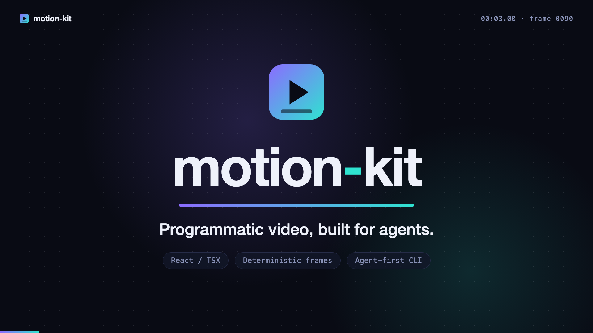
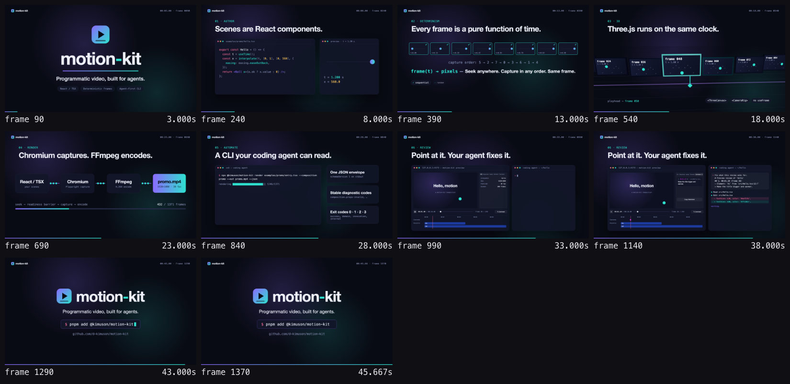
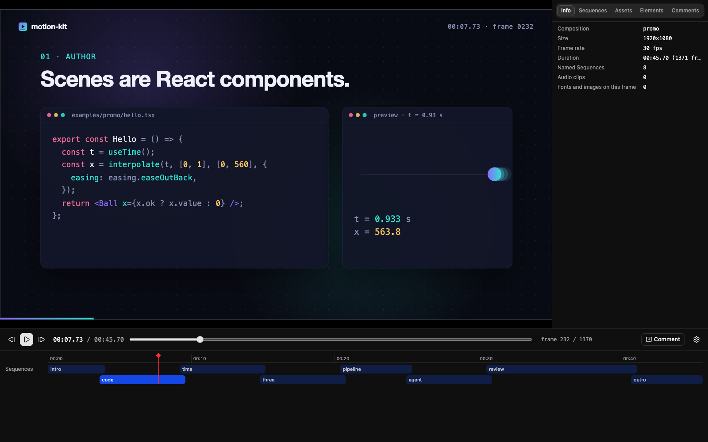

<div align="center">

# motion-kit

**An agent-first framework for programmatic video.**

Your coding agent writes the scenes in React/TSX, looks at its own frames, and renders the MP4.

[](https://www.npmjs.com/package/@kimuson/motion-kit)
[](https://www.npmjs.com/package/@kimuson/motion-kit)
[](https://github.com/d-kimuson/motion-kit/actions/workflows/check.yaml)
[](LICENSE)



</div>

## Getting started

motion-kit is meant to be driven by a coding agent. Add the `motion-kit` skill and ask for a video;
the skill tells the agent how to set up a project, run the CLI and read the guides that ship with the
package.

```bash
npx skills add d-kimuson/motion-kit
```

Or as a Claude Code plugin:

```text
/plugin marketplace add d-kimuson/motion-kit
/plugin install motion-kit@motion-kit
```

To try it without installing the skill, point the agent at it in your prompt:

```text
Make a 15-second launch video for my CLI tool with motion-kit.
Reference: https://raw.githubusercontent.com/d-kimuson/motion-kit/main/skills/motion-kit/SKILL.md
```

## How it works

### 1. The agent writes the video as React

A video is a **Composition**: a React component plus its size, frame rate and duration, exported from
an entry file. Every frame is a pure function of time, so the same frame always renders the same
pixels.

```tsx
// entry.tsx
import { defineComposition, defineCompositions, useTime } from '@kimuson/motion-kit';
import { easing, interpolate } from '@kimuson/motion-kit/motion';
import { z } from 'zod';

const props = z.object({ title: z.string().default('Hello from motion-kit') });

const Scene = ({ title }: z.infer<typeof props>) => {
  const opacity = interpolate(useTime(), [0, 0.6], [0, 1], { easing: easing.easeOutCubic });
  return (
    <div
      style={{
        width: '100%',
        height: '100%',
        display: 'grid',
        placeItems: 'center',
        background: '#07080c',
        color: '#f8f8f8',
        fontFamily: 'system-ui, sans-serif',
        fontSize: 96,
      }}
    >
      <p style={{ margin: 0, opacity: opacity.ok ? opacity.value : 0 }}>{title}</p>
    </div>
  );
};

export const compositions = defineCompositions([
  defineComposition({
    id: 'hello',
    component: Scene,
    schema: props,
    width: 1920,
    height: 1080,
    fps: { numerator: 30, denominator: 1 },
    durationInFrames: 150,
  }),
]);
```

### 2. The agent checks its own frames

`contact-sheet` samples the timeline into one labelled PNG, so the agent sees the whole flow in a
single image instead of watching a video. `frame` captures any one frame the same way.

```bash
npx @kimuson/motion-kit contact-sheet entry.tsx --every 30 --out sheet.png
```

The sheet of the 46-second promo video in [`examples/promo`](examples/promo/):



### 3. You review in the preview and hand comments back

`preview` serves a page where you scrub and play the Composition with its audio and a timeline of its
Sequences. Click an element to comment on it, then Copy Markdown: each comment carries its time, the
JSX file and line, and a `motion-kit frame` command, ready to paste back to the agent.

```bash
npx @kimuson/motion-kit preview entry.tsx
```



### 4. The agent renders the MP4

```bash
npx @kimuson/motion-kit render entry.tsx --out out.mp4
```

Every command takes `--json` and answers with one versioned envelope, and a failure is a Diagnostic
with a stable `code` and a `hint` rather than a stack trace. That is what lets the agent go round
write, check and fix on its own.

## Documentation

The guides ship inside the npm package and `npx @kimuson/motion-kit docs` prints them, so the agent
reads the guide of the version it runs.

- [Documentation index](docs/index.md) — requirements, a quickstart and the package surface
- [Getting started](docs/guide/getting-started.md) · [Authoring](docs/guide/authoring.md) ·
  [CLI](docs/guide/cli.md) · [Three.js](docs/guide/three.md) ·
  [Determinism](docs/guide/determinism.md) · [Troubleshooting](docs/guide/troubleshooting.md)
- [Examples](docs/guide/examples.md) — four complete reference videos under [`examples/`](examples/)
- [Changelog](CHANGELOG.md)

## Contributing

Working on motion-kit itself (setup, building, testing) is covered in
[dev-docs/README.md](dev-docs/README.md).

## License

[MIT](LICENSE)
